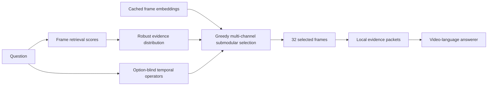

# EviLoom

**Training-free, distribution-aware evidence selection for long-video question answering.**

[中文说明](README_zh.md) · [Method](docs/METHOD.md) · [Results](docs/RESULTS.md) · [Reproduction](docs/REPRODUCTION.md)

EviLoom is the public name of the strongest **fully evaluated** method in this
project (internally called `PERD-v2`). It converts frame relevance scores into a
probability distribution, covers that distribution with a local
visual-temporal submodular objective, adds only calibrated temporal-relation
channels, and presents the selected frames as local evidence packets.

The method is training-free and answer-option-blind during frame selection.
It consumes cached frame embeddings and retrieval scores; it does not ship a
dataset, checkpoint, video, or private cache.

## Why it exists

Plain Top-K repeatedly selects near-duplicate frames around the strongest peak.
That works for a single local event, but it can miss separated evidence modes in
long videos. EviLoom treats relevance as **demand over time** and selects frames
that jointly balance:

1. direct query relevance;
2. local visual-temporal coverage;
3. bounded, reliability-calibrated temporal evidence channels;
4. coherent presentation to the answer model.



## Verified results

Full-split results below were read back from the experiment server on
2026-10-15. All runs use **Qwen2.5-VL-7B-Instruct**, **32 frames**, and the same
LMMS-Eval-based answering protocol.

| Dataset | Questions | EviLoom score |
|---|---:|---:|
| Video-MME | 2,700 | 63.33 |
| LongVideoBench | 1,337 | 61.56 |
| MLVU | 2,174 | **69.41** |
| LVBench | 1,549 | 45.51 |

On the full MLVU split under this unified protocol, EviLoom scored higher than
the baselines we completed:

| Selector | MLVU |
|---|---:|
| Uniform | 62.44 |
| FOCUS | 66.94 |
| AKS | 67.41 |
| BOLT | 68.03 |
| Top-K | 68.19 |
| **EviLoom** | **69.41** |

These numbers compare selectors inside one local protocol; they are not claimed
as exact reproductions of every original paper's model and preprocessing stack.
See [the scope and limitations](docs/RESULTS.md).

## Install

```bash
git clone https://github.com/LINGXIAO-aico/EviLoom.git
cd EviLoom
python -m pip install -e .
```

## Minimal usage

```python
import numpy as np
from eviloom import SelectorConfig, select_eviloom

# N cached candidate frames, sorted by time.
query_scores = np.load("query_scores.npy")          # [N]
frame_features = np.load("frame_features.npy")      # [N, D], normalized or raw
timestamps = np.load("timestamps.npy")              # [N]

result = select_eviloom(
    query_scores,
    frame_features,
    timestamps,
    config=SelectorConfig(budget=32),
)

print(result.indices)
print(result.packets)
```

Run the dependency-light synthetic demo:

```bash
python examples/synthetic_demo.py
```

## Repository map

```text
src/eviloom/          portable selector, operators, planner schema, packets
configs/              validated B=32 configuration
examples/             synthetic end-to-end example
tests/                deterministic unit tests
results/              compact, non-sensitive aggregate tables
docs/                 method, evaluation scope, provenance and reproduction
```

## Research status

- **EviLoom** is the recommended release method because it is the only advanced
  project variant evaluated on all four complete benchmark splits.
- **EviLoom-C** (formerly C-PERD) is included as an experimental
  complement-aware refinement. It improved MLVU and LVBench development
  subsets but regressed on LongVideoBench, so it is not presented as the main
  result.
- Later QTR, CEIS and RCD explorations were audited and did not provide a stable
  cross-dataset improvement over EviLoom.

## License

MIT. See [LICENSE](LICENSE).
