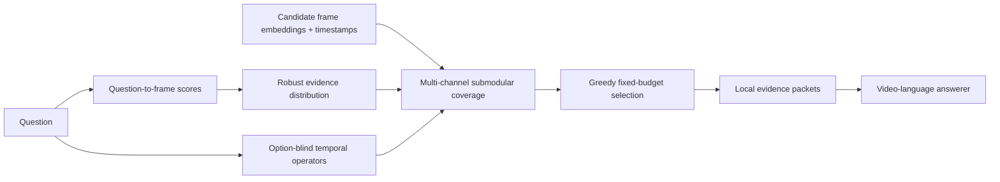

# EviLoom

**Distribution-aware evidence coverage for long-video question answering.**

[](https://github.com/LINGXIAO-aico/EviLoom/actions/workflows/tests.yml)


[中文说明](README_zh.md) · [Method](docs/METHOD.md) · [Results](docs/RESULTS.md) · [Reproduction](docs/REPRODUCTION.md)

Long-video QA is often limited by a small visual budget: a model may receive only
32 frames from a video containing hundreds or thousands of candidates. Ranking
frames independently is wasteful—Top-K tends to spend several slots on almost
identical frames near one relevance peak while missing weaker but complementary
evidence elsewhere in the video.

**EviLoom turns frame retrieval into a set-coverage problem.** It converts noisy
retrieval scores into an evidence distribution, covers that distribution with a
visual-temporal submodular objective, adds bounded temporal-relation channels when
the question explicitly requires them, and organizes the selected frames into
local evidence packets for the answer model.

The selector is training-free, answer-option-blind, model-agnostic and produces an
exact fixed-size frame set.

## Highlights

- **Distribution, not ranking.** Relevance is treated as demand distributed over
  the timeline instead of a list of independent frame scores.
- **Redundancy-aware selection.** A frame covers nearby, visually similar evidence;
  subsequent frames are rewarded for covering evidence that remains unexplained.
- **Safe temporal reasoning.** Explicit relations such as *first*, *before*,
  *after* and *again* create independent evidence channels whose weights are
  calibrated from retrieval reliability.
- **Fixed and auditable compute.** Greedy optimization returns exactly `B` frames
  and records each frame's marginal gain and evidence role.
- **Portable integration.** EviLoom consumes cached scores, embeddings and
  timestamps, so it can sit between any retriever and any video-language model.

## Method

### Problem formulation

For each candidate frame `i`, EviLoom receives its timestamp `t_i`, visual
embedding `x_i`, and question-retrieval score `s_i`. The task is to choose a
set `S` of exactly `B` frames that preserves both the strongest direct evidence
and the distinct evidence regions needed to answer the question.



### 1. Robust evidence field

Raw similarity scores from different videos can have very different scales.
EviLoom median/MAD-standardizes the scores, clips extreme values and applies a
temperature-controlled softmax. The result is a probability distribution `p_i`
over the complete candidate timeline. Outliers no longer dominate merely because
one video has a wider score range.

### 2. Local visual-temporal coverage

Two frames should be considered redundant only when they are both visually similar
and temporally close. EviLoom therefore uses the local kernel

$$
K(i,j)=\max(\cos(x_i,x_j),0)\exp(-|t_i-t_j|/\tau),
$$

evaluated inside a bounded temporal window. Its base objective combines direct
relevance with facility-location coverage:

$$
F(S)=\alpha\sum_{i\in S}p_i
+(1-\alpha)\sum_j p_j\max_{i\in S}K(i,j).
$$

Selecting one frame reduces the marginal value of near-duplicates but does not
blindly force global diversity. A second frame remains valuable when it explains a
different visual state, a separated event, or an uncovered relevance mode.

### 3. Reliability-calibrated evidence channels

Some questions explicitly request an order relation rather than merely a relevant
scene. An option-blind planner may propose a visible target event and reference
event, but a proposal is not automatically trusted:

1. the question must license a supported operator (`first`, `last`, `before`,
   `after`, or recurrence);
2. target/reference queries must produce prominent retrieval peaks;
3. directional mass must lie on the valid side of the reference event;
4. weak channels are rejected and accepted weights are capped.

Each accepted channel keeps a separate probability distribution and a separate
coverage state. This prevents a speculative query from overwriting the original
question signal. If no channel is reliable, the method remains the
distribution-and-coverage selector—it does not collapse to plain Top-K.

### 4. Greedy optimization under an exact budget

At each step, EviLoom selects the frame with the largest total marginal gain across
the base evidence field and accepted auxiliary channels. The proxy objective is
non-negative, monotone and submodular, so greedy maximization under a cardinality
constraint inherits the classical `(1-1/e)` approximation guarantee.

### 5. Evidence packets

The chosen frames are sorted by time and grouped by temporal continuity and evidence
role before being passed to the answer model. Packetization never changes the frame
set; it only makes local event continuity explicit to the model.

## Results

### LongVideoBench case study: original research pipeline

This experiment used the complete 1,337-question validation split,
Qwen2.5-VL-7B-Instruct, a 32-frame budget, 1-fps candidates and subtitles. Every
method in the table used the same answering and scoring path.

| Selector | Accuracy |
|---|---:|
| Top-K | 55.50 |
| FOCUS (same local evaluation stack) | 55.57 |
| Top-K + evidence packets | 56.99 |
| **EviLoom** | **58.26** |

EviLoom improved accuracy by **+2.76 points over Top-K** and **+2.69 points over
FOCUS**. More importantly, it remained **+1.27 points above the packet-only
control**, showing that the gain was not explained solely by changing how frames
were presented to the answerer.

### Standardized LMMS-Eval study on MLVU

Under the project's common LMMS-Eval path with Qwen2.5-VL-7B-Instruct and 32
selected frames, EviLoom obtained the highest score among the completed selectors:

| Selector | MLVU macro score |
|---|---:|
| Uniform | 62.44 |
| FOCUS | 66.94 |
| AKS | 67.41 |
| BOLT | 68.03 |
| Top-K | 68.19 |
| **EviLoom** | **69.41** |

Additional full-split LMMS-Eval runs produced 63.33 on Video-MME, 61.56 on
LongVideoBench and 45.51 on LVBench. The original LongVideoBench table and the
LMMS-Eval table are intentionally reported separately: they use different frame
ingestion, prompting and scoring paths, so their absolute numbers should not be
cross-compared. Full protocol notes are available in [Results](docs/RESULTS.md).

## Quick start

```bash
git clone https://github.com/LINGXIAO-aico/EviLoom.git
cd EviLoom
python -m pip install -e .
```

```python
import numpy as np
from eviloom import SelectorConfig, select_eviloom

# N time-sorted candidate frames.
query_scores = np.load("query_scores.npy")      # [N]
frame_features = np.load("frame_features.npy")  # [N, D]
timestamps = np.load("timestamps.npy")          # [N]

result = select_eviloom(
    query_scores=query_scores,
    frame_features=frame_features,
    timestamps=timestamps,
    config=SelectorConfig(budget=32),
)

print(result.indices)      # exactly 32 selected frame indices
print(result.roles)        # contribution assigned to each selected frame
print(result.packets)      # temporally coherent groups for the answer model
print(result.diagnostics)  # marginal-gain trace and coverage statistics
```

Run the dependency-light demo and test suite:

```bash
python -m pip install -e ".[dev]"
python examples/synthetic_demo.py
pytest -q
```

## Integration contract

EviLoom deliberately does not own video decoding, embedding extraction or answer
generation. A production pipeline only needs to provide:

| Input | Shape | Description |
|---|---:|---|
| `query_scores` | `[N]` | question-to-frame retrieval scores |
| `frame_features` | `[N, D]` | cached visual embeddings |
| `timestamps` | `[N]` | sorted frame timestamps in seconds |
| `channels` | optional | validated auxiliary evidence distributions |

The output contains selected indices, timestamps, evidence roles, packets and a
step-by-step optimization trace. This separation makes the selector reusable with
CLIP, BLIP, LongCLIP or another retriever and with different video-language models.

## Repository structure

```text
src/eviloom/
  selector.py        robust distribution + submodular optimizer
  operators.py       calibrated temporal evidence channels
  planner.py         option-blind structured planner boundary
  packet.py          evidence-packet construction
  types.py           typed configuration and result objects
configs/             reference B=32 configuration
examples/            runnable synthetic example
tests/               deterministic unit tests
results/             compact aggregate benchmark tables
docs/                method, protocol and reproduction details
```

The repository contains no dataset videos, model checkpoints, private caches or
per-question predictions.

## License

MIT. See [LICENSE](LICENSE).
