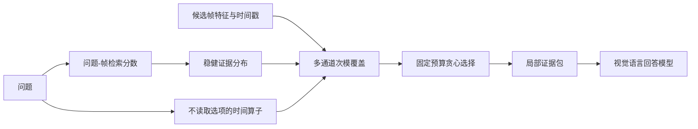

# EviLoom：面向长视频问答的分布式证据覆盖

**在固定帧预算下，不只寻找“最像问题”的画面，而是覆盖回答问题所需的完整证据。**

[English](README.md) · [方法细节](docs/METHOD.md) · [实验结果](docs/RESULTS.md) · [复现说明](docs/REPRODUCTION.md)

长视频问答通常只能向视觉语言模型输入很少的帧。例如，一个包含数百乃至数千个候选画面的长视频，最终可能只能保留32帧。传统Top-K把每一帧独立排序，容易在同一个高分片段附近连续选中大量重复画面，同时漏掉视频其他位置较弱但互补的证据。

**EviLoom把选帧问题重新建模为“有限预算下的证据覆盖”。** 它先把不稳定的相似度分数转化为整条时间轴上的证据概率分布，再利用视觉—时间次模目标减少重复、覆盖多个相关事件；当问题明确包含先后、首次、末次或重复等关系时，系统还会建立受可靠性约束的独立时间证据通道。最后，选中的帧会被整理成局部证据包交给回答模型。

整个选择过程无需训练、不读取答案选项、与具体回答模型解耦，并且始终输出严格固定数量的帧。

## 项目亮点

- **从“逐帧排名”转向“证据分布覆盖”**：高分区域是一片需要被解释的证据，而不是必须全部保留的一串帧。
- **同时考虑画面相似性和时间距离**：只抑制真正重复的邻近画面，不会为了多样性而盲目选取无关帧。
- **Planner只负责提出、不能直接决定**：时间查询必须经过检索峰强度和方向一致性验证，低可信结果不会污染原问题信号。
- **固定计算预算**：在任意候选帧数量下严格输出`B`帧，适合直接接入现有Video-LLM推理流程。
- **结果可以逐步追踪**：输出每次贪心选择的边际收益、帧角色、覆盖率和证据包，便于调试与审计。

## 算法原理

### 1. 输入与目标

对于第`i`个候选帧，系统接收时间戳`t_i`、视觉特征`x_i`以及问题与该帧的检索分数`s_i`。目标是在所有候选帧中选择严格`B`帧，使它们既保留最强的直接证据，又尽可能覆盖彼此分离、内容互补的证据区域。



### 2. 将相似度变成稳健证据分布

不同视频的相似度范围可能完全不同。EviLoom先使用中位数和MAD进行稳健标准化，裁剪异常值，再通过带温度的Softmax得到整条时间轴上的概率分布。这样可以避免少量异常高分支配全部帧预算，也能让不同视频之间使用一致的选择逻辑。

### 3. 局部视觉—时间覆盖

EviLoom认为两帧只有在“画面相似”且“时间接近”时才是冗余的。局部相似核为：

$$
K(i,j)=\max(\cos(x_i,x_j),0)\exp(-|t_i-t_j|/\tau).
$$

选择目标同时包含两部分：一部分直接奖励高概率帧；另一部分奖励当前帧能够覆盖多少尚未覆盖的证据质量。某个片段已经被代表后，其邻近重复帧的边际收益会自动下降，其他尚未覆盖的事件峰便有机会进入最终集合。

这与简单“拉开时间距离”不同：如果第二帧展示了不同状态或补充事件，即使时间接近，它仍可能带来较高收益；而画面相似但相隔很远的重复事件也可以作为独立证据保留。

### 4. 可靠性校准的时间证据通道

当问题明确包含`first`、`last`、`before`、`after`或“再次出现”等关系时，Planner可以提出目标事件和参考事件，但它不能查看答案选项，也不能通过枚举颜色、形状等方式猜答案。

一个Planner查询只有满足以下条件才会影响选帧：

1. 问题文本确实支持对应的时间操作；
2. 目标事件和参考事件都能在视频中形成清晰检索峰；
3. 候选峰位于参考事件的正确时间方向；
4. 校准后的权重大于最低阈值且不超过单通道与总通道上限。

每条证据通道拥有独立的分布和覆盖状态，不会先与原问题分数粗暴混合。没有可靠附加证据时，系统仍执行证据分布与次模覆盖，而不是退化为Top-K。

### 5. 固定预算的贪心优化

系统每一步选择总边际收益最高的帧，直到达到固定预算。使用的代理目标具有非负、单调和次模性质，因此在基数约束下具有经典的`(1-1/e)`贪心近似保证。工程上，这一过程无需训练，给定相同特征和配置即可确定性复现。

### 6. 局部证据包

最终帧按照时间与证据角色分组，使回答模型能够看到连续事件，而不是一串缺少上下文的孤立截图。证据包只改变呈现顺序和分组，不增加、删除或替换任何已选帧。

## 实验结果

### LongVideoBench：原始研究评测流程

该实验使用完整1,337题验证集、Qwen2.5-VL-7B-Instruct、32帧预算、1 fps候选帧并启用字幕。表中方法使用完全相同的回答与评分流程。

| 选帧方法 | 准确率 |
|---|---:|
| Top-K | 55.50 |
| FOCUS（同一本地评测栈） | 55.57 |
| Top-K + 证据包 | 56.99 |
| **EviLoom** | **58.26** |

EviLoom相对Top-K提升 **2.76个百分点**，相对FOCUS提升 **2.69个百分点**。更重要的是，它比使用相同证据包呈现方式的Top-K仍高 **1.27个百分点**，因此这部分收益不能只用“回答器看帧方式不同”来解释，证据覆盖选择本身也产生了贡献。

### MLVU：统一LMMS-Eval流程

在Qwen2.5-VL-7B-Instruct、32帧和同一LMMS-Eval回答流程下：

| 选帧方法 | MLVU宏平均分数 |
|---|---:|
| Uniform | 62.44 |
| FOCUS | 66.94 |
| AKS | 67.41 |
| BOLT | 68.03 |
| Top-K | 68.19 |
| **EviLoom** | **69.41** |

同一LMMS-Eval流程下，EviLoom在Video-MME、LongVideoBench和LVBench全量实验中的分数分别为63.33、61.56和45.51。原始LongVideoBench流程与LMMS-Eval流程在帧输入、Prompt和评分路径上不同，因此本项目将两组结果分开报告，不直接横向比较绝对数值。更详细的实验边界见[实验结果说明](docs/RESULTS.md)。

## 快速开始

```bash
git clone https://github.com/LINGXIAO-aico/EviLoom.git
cd EviLoom
python -m pip install -e .
```

```python
import numpy as np
from eviloom import SelectorConfig, select_eviloom

# N个候选帧已按时间排序。
query_scores = np.load("query_scores.npy")       # [N]
frame_features = np.load("frame_features.npy")  # [N, D]
timestamps = np.load("timestamps.npy")          # [N]

result = select_eviloom(
    query_scores=query_scores,
    frame_features=frame_features,
    timestamps=timestamps,
    config=SelectorConfig(budget=32),
)

print(result.indices)      # 严格32个帧索引
print(result.roles)        # 每个入选帧的证据角色
print(result.packets)      # 交给回答模型的局部证据包
print(result.diagnostics)  # 边际收益与覆盖诊断
```

运行轻量示例和单元测试：

```bash
python -m pip install -e ".[dev]"
python examples/synthetic_demo.py
pytest -q
```

## 接入现有系统

EviLoom不绑定视频解码器、特征模型或回答模型。接入时只需要提供：

| 输入 | 形状 | 含义 |
|---|---:|---|
| `query_scores` | `[N]` | 问题与候选帧的检索分数 |
| `frame_features` | `[N, D]` | 已缓存的视觉特征 |
| `timestamps` | `[N]` | 按时间排序的秒级时间戳 |
| `channels` | 可选 | 已通过验证的附加证据分布 |

输出包含帧索引、证据角色、局部证据包以及逐步优化轨迹。因而既可以使用CLIP、BLIP、LongCLIP等检索器，也可以接入不同的Video-LLM回答器。

## 项目结构

```text
src/eviloom/
  selector.py        稳健证据分布与次模优化器
  operators.py       可靠性校准的时间证据通道
  planner.py         不读取答案选项的结构化Planner边界
  packet.py          局部证据包构建
  types.py           配置与结果数据结构
configs/             B=32参考配置
examples/            可直接运行的合成示例
tests/               确定性单元测试
results/             精简后的聚合实验表格
docs/                方法、协议与复现说明
```

仓库不包含数据集视频、模型权重、私有缓存或逐题预测文件。

## License

MIT，详见[LICENSE](LICENSE)。
